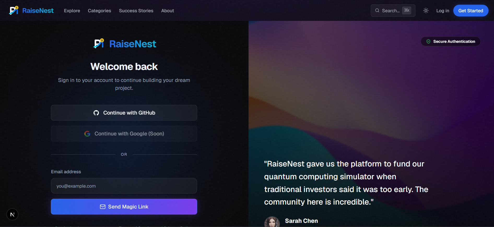
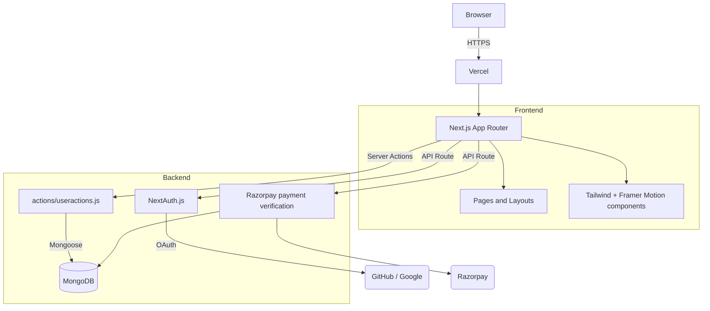
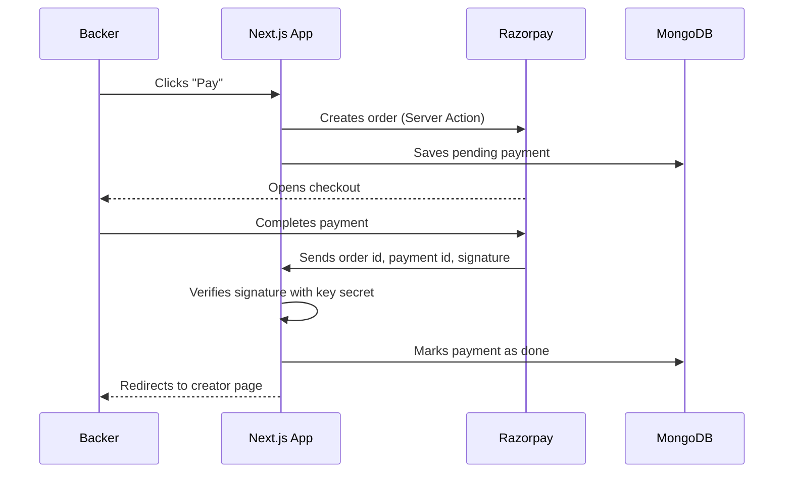

<div align="center">
  

  <h1 align="center">RaiseNest</h1>

  <p align="center">
    <strong>Launch Ideas. Build the Future.</strong>
    <br />
    A crowdfunding web app for student innovators, built with Next.js, React, Tailwind CSS, NextAuth and Razorpay.
  </p>

  <p align="center">
    
    
    
    
    <a href="https://raise-nest-crowd-funding.vercel.app"></a>
  </p>

  <p align="center">
    <a href="#-live-demo">View Demo</a>
    ·
    <a href="#-getting-started">Get Started</a>
    ·
    <a href="https://github.com/Divyanshu-2907/RaiseNest-CrowdFunding/issues">Report a Bug</a>
  </p>
</div>

---

> **Portfolio project.** RaiseNest is a personal project, not a live business. The campaigns, creators, backers and platform numbers you see in the UI are **mock data** from `lib/mockData.ts`, used to show how the interface looks with real content. Payments run in Razorpay **test mode**.

---

## 🖼 Preview

<div align="center">
  
</div>

---

## 📊 Platform at a Glance (Mock Data)

These are sample numbers displayed on the landing page to demo the UI. They are not real usage figures.

<div align="center">

| 🎓 Students | 💰 Raised | 🚀 Campaigns | ✅ Success Rate |
|:---:|:---:|:---:|:---:|
| 5,000+ *(mock)* | ₹2.5 Cr *(mock)* | 850+ *(mock)* | 96% *(mock)* |

</div>

---

## 📑 Table of Contents

- [About RaiseNest](#-about-raisenest)
- [Key Features](#-key-features)
- [How It Works](#-how-it-works)
- [Campaign Categories](#-campaign-categories)
- [Screenshots](#-screenshots)
- [Live Demo](#-live-demo)
- [Architecture](#-architecture)
- [Tech Stack](#-tech-stack)
- [Project Structure](#-project-structure)
- [Getting Started](#-getting-started)
- [Environment Variables](#-environment-variables)
- [Data Model](#-data-model)
- [Design System](#-design-system)
- [Roadmap](#-roadmap)
- [Author](#-author)

---

## 📖 About RaiseNest

### Problem
Student innovators, indie researchers and early-stage builders often struggle to raise their first bit of money. Most crowdfunding platforms charge high fees and feel heavy to use.

### Idea
RaiseNest is a crowdfunding app where creators set up a page, share it, and receive contributions through Razorpay. I built it to practise a full Next.js App Router project end to end: UI components, theming, animation, OAuth sign-in and payment verification.

### Who it's designed for
- 🎓 **University students** funding thesis projects, prototypes and campus startups
- 👨‍💻 **Open-source developers** looking for support for their work
- 🚀 **Early-stage founders** testing demand for an MVP

---

## ✨ Key Features

### Authentication
- GitHub and Google sign-in through **NextAuth.js**
- Session handling and CSRF protection provided by NextAuth

### Payments
- **Razorpay** checkout for INR contributions (test mode)
- Every payment's signature is verified on the server (`app/api/razorpay/route.js`) before it is marked as done in MongoDB

### UI and Experience
- Landing page with an animated hero, live-style funding card and donation feed (mock data)
- Explore page for browsing campaigns by category (mock data)
- Creator profile and payment page at `/[username]`
- Creator dashboard, campaign creation page, success stories, about, login and custom 404 pages
- Reusable UI components (`Button`, `Card`, `Input`, `Badge`, `Avatar`) built with Tailwind CSS and CVA
- Light and dark themes (dark by default) via `next-themes`
- Animations with **Framer Motion**, toast messages with React Toastify, confetti on success
- Responsive layouts for mobile, tablet and desktop

### SEO
- Generated favicon, Apple icon and Open Graph / Twitter images through Next.js route files
- Route-level `loading.tsx` for instant loading states

---

## 🔄 How It Works

```text
1. Sign in  →  2. Set up your page  →  3. Share it  →  4. Receive contributions
```

1. **Sign in** with GitHub or Google.
2. **Set up your page** with your story and Razorpay details.
3. **Share it** with friends, classmates and backers.
4. **Receive contributions** through Razorpay. Each payment is verified before it is recorded.

---

## 🗂 Campaign Categories

`Technology` · `AI` · `Robotics` · `Education` · `Healthcare` · `Gaming` · `Environment` · `IoT` · `FinTech`

---

## 📸 Screenshots

| Landing Page | Explore Grid |
|:---:|:---:|
|  |  |

| Campaign Detail | Creator Dashboard |
|:---:|:---:|
|  |  |

| Authentication | Payment Modal |
|:---:|:---:|
|  |  |

---

## 🌐 Live Demo

**[raise-nest-crowd-funding.vercel.app](https://raise-nest-crowd-funding.vercel.app)**

The demo shows mock campaigns and stats. Payments use Razorpay test mode, so no real money moves.

---

## 🏗 Architecture



### Payment Flow



---

## 🛠 Tech Stack

| Technology | Purpose |
|------------|---------|
| **Next.js 16** (App Router) | Framework, routing, server actions, API routes |
| **React 18** | UI components |
| **TypeScript / JavaScript** | Pages and components |
| **Tailwind CSS** | Styling and responsive layout |
| **Framer Motion** | Animations and transitions |
| **Radix Slot + CVA** | Reusable component variants |
| **next-themes** | Light and dark mode |
| **NextAuth.js** | GitHub and Google OAuth |
| **MongoDB + Mongoose** | Users and payments |
| **Razorpay** | Payment checkout and verification |

---

## 📁 Project Structure

```text
RaiseNest-CrowdFunding/
├── actions/              # Server Actions (payments, user profile)
├── app/
│   ├── [username]/       # Creator profile and payment page
│   ├── api/
│   │   ├── auth/         # NextAuth route
│   │   └── razorpay/     # Payment verification route
│   ├── campaigns/create/ # Campaign creation page
│   ├── dashboard/        # Creator dashboard
│   ├── explore/          # Campaign discovery
│   ├── login/            # Sign-in page
│   └── ...               # About, categories, success stories, 404
├── components/
│   ├── ui/               # Reusable UI components
│   ├── hero/             # Landing page hero pieces
│   ├── Dashboard.tsx
│   └── PaymentPage.tsx
├── db/                   # MongoDB connection
├── lib/                  # mockData.ts, utils.ts
├── models/               # User and Payment schemas
└── public/               # Images and screenshots
```

---

## 🚀 Getting Started

### Prerequisites
- Node.js 18.17+
- A MongoDB database (Atlas or local)
- A Razorpay account in test mode
- A GitHub OAuth app

### Setup

```bash
git clone https://github.com/Divyanshu-2907/RaiseNest-CrowdFunding.git
cd RaiseNest-CrowdFunding
npm install
```

Create a `.env.local` file in the root with the variables below, then run:

```bash
npm run dev
```

Open [http://localhost:3000](http://localhost:3000).

---

## 🔐 Environment Variables

| Variable | Description |
|----------|-------------|
| `NEXT_PUBLIC_URL` | App base URL, e.g. `http://localhost:3000` |
| `MONGODB_URI` | MongoDB connection string |
| `NEXTAUTH_URL` | Auth callback URL |
| `NEXTAUTH_SECRET` | Secret used to sign sessions |
| `GITHUB_ID` | GitHub OAuth client ID |
| `GITHUB_SECRET` | GitHub OAuth client secret |
| `NEXT_PUBLIC_KEY_ID` | Razorpay key ID (test) |
| `KEY_SECRET` | Razorpay key secret (test) |

---

## 🗄 Data Model

Two Mongoose models live in `models/`:

- **User:** profile details, username and the creator's Razorpay keys
- **Payment:** amount, sender, receiving creator, Razorpay order id and whether it is done

Campaign listings on the Explore and landing pages come from `lib/mockData.ts` for now.

---

## 🎨 Design System

- **Fonts:** Geist Sans and Geist Mono
- **Colors:** dark slate backgrounds with a primary blue (`#2563EB`)
- **Glass effects:** `backdrop-blur` and translucent backgrounds on floating cards
- **Components:** `Button`, `Card`, `Input`, `Badge` and `Avatar` with variants managed by CVA
- **Motion:** entry animations and hover effects with Framer Motion

---

## 🗺 Roadmap

- [x] GitHub sign-in with NextAuth
- [x] Razorpay checkout and payment verification
- [x] Creator dashboard
- [x] Light and dark themes
- [ ] Store campaigns in MongoDB instead of mock data
- [ ] Tests with Vitest and React Testing Library
- [ ] AI helper for writing campaign descriptions

---

## 👨‍💻 Author

**Divyanshu Kumar** · [GitHub](https://github.com/Divyanshu-2907) · [LinkedIn](https://linkedin.com/in/divyanshukr004)
